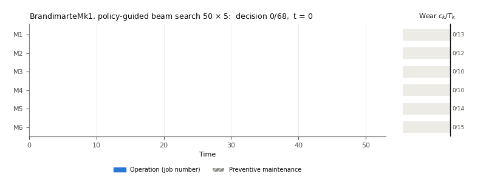

# Joint scheduling of production and wear-driven preventive maintenance in a flexible job shop using a policy-guided beam search

Code, extended benchmark instances and raw results of the article of the same title (submitted). The repository
contains everything needed to **reproduce every table and figure of the article and of its Supplementary Material**
from the raw results, to **re-run any experiment**, and to **evaluate a new method under the same protocol** (same
instances, feasibility check, reference and statistics).

## Problem

A flexible job shop in which every machine accumulates wear while it processes: an operation of length *p* may start on
machine *k* only if the wear *c_k* of the machine satisfies *c_k + p ≤ T_k*, and a preventive maintenance of length
*M_k* resets the wear to zero. The assignment and sequence of the operations and the moments of the maintenances are
decided jointly; the objective is the makespan. The thresholds are known and no breakdown can occur.

## Method

A filtered beam search in the sense of Ow and Morton (1988). At each node, a policy network keeps the *K* most promising
actions (launch an operation on a machine, maintain a machine, wait). Each kept action is evaluated by completing the
schedule with a priority rule that also decides the maintenances (Numba, about 0.1 ms per completion). Duplicate states
and states whose lower bound cannot improve on the best schedule are discarded, and the *B* best states are kept. The
network is trained on generated instances by imitation of a tuned simulated annealing, proximal policy optimisation and
self-imitation. A constraint programming model with maintenance segments provides lower bounds and proven optima.

<p align="center">
  
</p>

*Schedule built by the policy-guided beam search (50 × 5) on Brandimarte Mk01, replayed decision by decision (black
outline: last decision). Right: wear of each machine relative to its threshold, reset by preventive maintenance.
Makespan 51; proven optimum 50.*

## Repository layout

| Path | Content |
|---|---|
| `jssp_pm/` | Core library: instances and wear protocol (`fjsp_instance.py`), event simulator and decision process (`fjsp_sim.py`, `fjsp_env3.py`), policy network (`reseaux.py`), PPO (`fjsp_ppo.py`), completion engine and lower bound (`moteur_rapide.py`), beam search (`anticipation.py`), CP model with maintenance segments (`fjsp_cpsat.py`) |
| `anticiper.py` | Beam search on the benchmark instances |
| `comparer_rl.py` | Policy alone: greedy and best of *N* samples |
| `train_v3.py` | Reinforcement learning stages (PPO and self-imitation) |
| `imitation/` | Expert schedules (`experts.jsonl`, 2 000 schedules of simulated annealing) and imitation stage |
| `metaheuristiques/` | Simulated annealing, tabu search and genetic algorithm (one encoding, one decoder) |
| `reglage_taguchi/` | Taguchi tuning of the metaheuristics and retained parameters |
| `regles_priorite/` | Dispatching rules |
| `cpsat_article1.py`, `cpsat_sans_depart.py` | CP-SAT with and without a starting schedule (bounds, proven optima, CP-SAT alone) |
| `outils/` | **Independent schedule checker** (`verifier_planning.py`), instance export, analyses |
| `experiences_article1/` | Experiment launcher (`lancer.py`), statistics, table and figure scripts, protocol log (`PROTOCOLE.md`), execution logs (`journaux/`), outputs (`resultats/`) |
| `banque_resultats/` | **Raw results**: one line per run and the complete schedule of every run |
| `models/` | Trained networks |
| `Instances/` | Benchmark files and their wear parameters |
| `externe/` | Evaluation of the published model of Song et al. (2023) on the same instances (companion analyses) |
| `comparaisons/`, `resultats_metaheuristiques/`, `resultats_regles/` | Per-campaign summaries written by the scripts |
| `docs/` | Animation shown above |

File names, identifiers, comments and the protocol log are in French. Method labels in the raw results:
`Recuit simulé` = simulated annealing, `Recherche tabou` = tabu search, `Algorithme génétique` = genetic algorithm,
`RL:imit-ft` = trained policy (final network), `Faisceau:regle` = beam search without filter, `RL:aleatoire-g0` =
untrained network, `Faisceau:filtre-regle|fin|borne` = beam search with a simple filter (priority rule, earliest
finish, lower bound). In configurations: `glouton` = greedy, `echantillons` = samples, `faisceau=B,k=K` = beam search
*B* × *K*.

## Installation

Tested with Python 3.11 on Windows 11 (CPU only; no GPU is needed).

```bash
python -m venv .venv
.venv\Scripts\activate            # Linux/macOS: source .venv/bin/activate
pip install torch --index-url https://download.pytorch.org/whl/cpu
pip install -r requirements.txt
python -m pytest -q tests          # unit tests of the simulator, completion engine and beam search
```

All commands are run from the root of the repository. The schedules of the raw results are shipped compressed
(`solutions*.jsonl.gz`) and are decompressed automatically the first time `banque_resultats` is imported.

## Instances

134 public instances are computed: Brandimarte Mk01–Mk10, Hurink edata, rdata and vdata la01–la40, and Kacem (four
instances). Seven Hurink instances serve for the Taguchi tuning of the metaheuristics and are excluded from all
analyses, which leaves **127 test instances** with 4 to 30 jobs and 5 to 15 machines.

The benchmark files contain no wear parameters. They are added by a reproducible protocol
(`jssp_pm/fjsp_instance.py`, function `attach_wear_v3`, regime A, seed 0): with *u* the mean of the shortest
processing times and *L̄* the mean machine load,
*T_k* = max(round(*φ_k* · max(0.5 *L̄*, 3 *u*)), longest eligible operation on *k*), *φ_k* ~ U[0.8, 1.2];
*M_k* = max(1, round(*u*)). The resulting values are listed in `Instances/parametres_usure_regime_A.csv` (one line
per machine) and `Instances/parametres_usure_regime_A.json` (one entry per instance, with its role: test or tuning).
They can be regenerated with `python -m outils.exporter_instances`.

```python
from metaheuristiques.instances import charger_instances
instances = charger_instances(["Brandimarte", "HurinkLa", "Kacem"], regime="A")   # 134 instances
inst = instances[0]          # inst.P (operations × machines, 0 = not eligible), inst.job_ops, inst.T, inst.M
```

## Raw results

| File | Content |
|---|---|
| `banque_resultats/resultats.csv` + `solutions.jsonl.gz` | Protocol of the article (35 418 runs) |
| `resultats_mu3.csv` + `solutions_mu3.jsonl.gz` | Maintenances three times longer (μ = 3) |
| `resultats_phi1.csv`, `resultats_phi2.csv` + schedules | Two other draws of the threshold factors φ_k |
| `resultats_TkLk.csv` + `solutions_TkLk.jsonl.gz` | Classical problem with T_k = L_k (companion analyses) |

The thresholds multiplied by 0.7 and 1.5 are stored in the main bank (column `facteur_seuil`). The separate banks are
selected by environment variables (`FJSP_MU=3`, `FJSP_GRAINE_PHI=1|2`, `FJSP_TK_LK=1`), so that runs of different
protocols are never mixed. Each line of a bank gives the instance, regime, threshold factor, method, configuration,
seed, makespan, number of maintenances, running time, date, number of evaluated schedules and the identifier of the
complete schedule.

## Reproducing the article (minutes, from the raw results)

No number is copied by hand: every table is produced by a script from the raw results or from the reports of the
analysis scripts. Commands are `python -m experiences_article1.<script>` unless stated otherwise; outputs go to
`experiences_article1/resultats/`.

| Article | Script | Output |
|---|---|---|
| Table 2 (comparison of all methods) | `statistiques --methodes experiences_article1/methodes_principal_sans_hybride.json --nom principal_provisoire` | `principal_provisoire.*` |
| Tables 3, 5 and 7 (equal budget, equal time, maintenance placement) | `tableaux_article` | `tab_budget.tex`, `tab_temps.tex`, `tab_maintenance.tex` |
| Table 4 (lower bounds, proven optima, best known) | `tableau_bornes` | `tab_bornes.tex` |
| Tables 6 and 8 (families, variants of the generator) | `tableaux_caie` | `tab_familles_caie.tex`, `tab_robustesse_caie.tex` |
| Figure 1 (CP model) and Figure 2 (beam search) | `figure_modele_cp`, `figure_faisceau` | `schema_modele_cp.pdf`, `schema_faisceau.pdf` |
| Figure 3 (schedules on Mk01) | `figure_gantt_resultats` | `gantt_resultats_BrandimarteMk1.pdf` |
| Figure 4 (quality versus evaluations) | `tests_qualite_budget`, then `figure_qualite_budget_caie` | `qualite_budget_caie.pdf` |
| Supplementary Figures S1–S3 (proofs, training) | `figure_segments`, `figure_preuve_completude`, `figure_entrainement` | `schema_*.pdf` |
| Supplementary Table S3 (beam search without filter, components) | `statistiques --methodes experiences_article1/methodes_ablations_caie.json --nom ablations_caie` | `ablations_caie.*` |
| Supplementary Table S4 (CP-SAT alone at equal time) | `tableaux_article` | `tab_cpsat.tex` |

The intermediate analyses read by these scripts are produced by `tests_qualite_budget`, `tests_qualite_temps`
(`--sous-ensemble E10b` and `union`), `outils.analyse_e9b` and step E15 of `lancer`.

## Companion analyses

The repository also contains analyses that are not reported in the article: the comparison of the learned filter with
simple filters at equal settings, budgets and computing times, the ablation of tie-breaking, training stages and
seeds, a filter trained for the search, the classical problem, the comparison with Song et al. (2023), and a table
of all declared decision rules with their outcomes. Their analysis scripts are `analyse_revision_<campaign>`
(reports `resultats/revision_<campaign>.md`) and their tables are produced by `tableaux_revision`,
`tableaux_revision3`, `tableaux_revision4`, `tableau_gain_global`, `tableau_decisions` and `figure_qualite_budget`.

## Re-running the experiments

Every experiment is a step of `experiences_article1/lancer.py`. The settings and decision rules of each step were
written in `experiences_article1/PROTOCOLE.md` before the corresponding computations; each entry of the log is dated.

```bash
python -m experiences_article1.lancer --liste                         # steps and estimated cost
python -m experiences_article1.lancer --etape E5 --essai              # print the commands without running them
python -m experiences_article1.lancer --etape E5 --processus 8        # run
```

| Step | Content |
|---|---|
| E0 | Unit tests and machine information |
| E1 | Dispatching rules |
| E2, E3 | Metaheuristics (Taguchi parameters) from 2 000 to 200 000 evaluations |
| E4 | Policy alone: greedy and best of 100 samples × 5 seeds |
| E5, E5b | Policy-guided beam search, grid of settings *B* × *K* |
| E6, E6b | Beam search without filter, untrained network, without pruning, without duplicate removal |
| E9, E9b | CP-SAT (bounds and proven optima); CP-SAT alone at the running times of the beam search |
| E10, E10b | Wall-clock time on one process, idle machine (54 and 36 instances) |
| E15 | Value of the maintenance decisions for fixed sequences |
| R4, D3, B2, B2b | Variants of the generator: μ = 3, threshold factors 0.7 and 1.5, two other draws of φ_k |
| E7, E8, E10s, E11, E12, R1, R2, D1, D2, D4, D5, A1, B1, B3 | Companion analyses (classical problem, Song et al., training seeds, simple filters, equal budget, time of the filters, active decoder, tie-breaking) |

**Important.** The scripts never re-run a configuration that is already in the result bank (same instance, method,
configuration and seed). To re-run an existing configuration, use a new method name (`--nom`), the option `--forcer`
of the comparison scripts, or move the bank files aside to start from an empty bank. Wall-clock times are meaningful
only for the steps run on a single process on an idle machine (E9b, E10, E10b, E10s, D2, B3).

Example: policy-guided beam search 5 × 4 on the Brandimarte instances, under a new name:

```bash
python anticiper.py --modele models/imitation/cand_ft_best.pt --nom demo --largeur 5 --k 4 --familles Brandimarte --processus 2
```

## Networks

| File | Role |
|---|---|
| `models/imitation/cand_ft_best.pt` | **Network used in the article** (training seed 0, after PPO) |
| `models/imitation/cand_best.pt` | Network after the imitation stage only |
| `models/imitation/cand_ft_g1_best.pt`, `cand_ft_g2_best.pt` | Training seeds 1 and 2 (companion analyses); `cand_g*_best.pt` and `cand_ft_g*_ppo_best.pt` are their intermediate stages |
| `models/aleatoire/cand_aleatoire_g0.pt` | Untrained network |
| `models/filtre/filtre_best.pt` | Network retrained for the filtering role (companion analysis; no epoch improved the validation, so it is identical in behaviour to the final network) |

To train the network from scratch:

```bash
python -m imitation.experts --nombre 2000 --evaluations 50000 --parametres reglage_taguchi/parametres_retenus.json --processus 8   # optional: experts.jsonl is provided
python -m imitation.entrainer --reseau candidats --epoques 20 --seed 0 --out models/imitation/cand
python train_v3.py --init models/imitation/cand_best.pt --lr 1e-4 --ppo_steps 300000 --seed 0 --out models/imitation/cand_ft
```

Training uses generated instances only; no benchmark instance is used for training, validation or model selection.
The hyperparameters are listed in `models/imitation/cand_ft_config.json` and in the Supplementary Material. On a
laptop CPU (Intel Core i5-1235U), the imitation stage takes about 6 min per epoch and the PPO stage about 11 min;
computing the 2 000 expert schedules takes about 2.4 h of CPU time.

## Evaluating a new method under the same protocol

1. Produce a schedule for each instance as a list of `(machine, start, end, type, job)` (0-based machine and job;
   `type` 1 = operation, 2 = maintenance with `job = -1`).
2. Check it with the independent checker, which verifies eligibility, processing times, precedences, overlaps,
   maintenance durations and the wear condition, and returns the makespan.
3. Record it in the result bank, with its number of evaluated schedules if relevant:

```python
from metaheuristiques.instances import charger_instances
from outils.verifier_planning import verifier
from banque_resultats import banque

for inst in charger_instances(["Brandimarte", "HurinkLa", "Kacem"], regime="A"):
    schedule = my_method(inst)                               # your method
    cmax = verifier(inst, schedule)                          # raises ValueError if infeasible
    n_pm = sum(1 for s in schedule if s[3] == 2)
    banque.ajouter(inst.name, "A", 1.0, "MyMethod", "budget=50000", 0, cmax, n_pm, 0,
                   temps_s=0.0, planning=schedule, evaluations=50000)
```

4. Add `{"label": "My method", "methode": "MyMethod", "config": "budget=50000"}` to a copy of
   `experiences_article1/methodes_principal_sans_hybride.json` and run `experiences_article1.statistiques` with it.
   The method is then compared with all other methods on the 127 test instances, with the same reference (simulated
   annealing, 50 000 evaluations, Taguchi parameters), bootstrap confidence intervals, win/tie/loss counts and paired
   Wilcoxon tests with Holm's correction. Proven optima and lower bounds come from the CP-SAT runs in the bank.

## Song et al. (2023)

The published model of Song et al. is not included. To re-run steps E8, E10s and B3, clone their repository
(Apache-2.0) into `externe/fjsp-drl` and install `externe/requirements_song.txt`:

```bash
git clone https://github.com/songwenas12/fjsp-drl externe/fjsp-drl
```

Their results on our instances are provided in `externe/resultats_song*.csv`.

## Hardware and software

Intel Core i5-1235U (12 logical cores), Windows 11, Python 3.11.9, PyTorch 2.14.0 (CPU), NumPy 2.4.6, Numba 0.68.0,
SciPy 1.17.1, OR-Tools 9.15.6755. The environment of every run is logged in
`experiences_article1/journaux/executions.jsonl`.

## License and citation

Code released under the MIT License (see `LICENSE`). The benchmark instance files are public benchmarks from the
literature (Brandimarte 1993; Hurink et al. 1994; Kacem et al. 2002) and remain subject to their original terms.
If you use this repository, please cite the article (see `CITATION.cff`).
